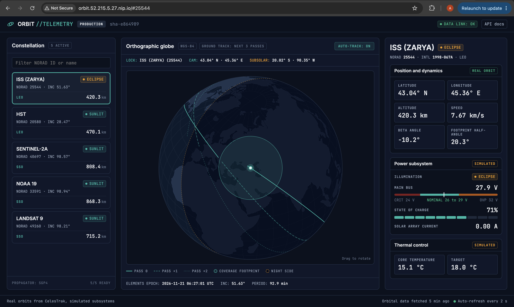
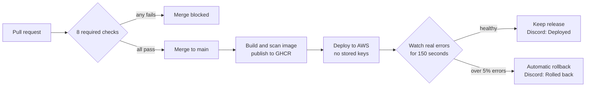
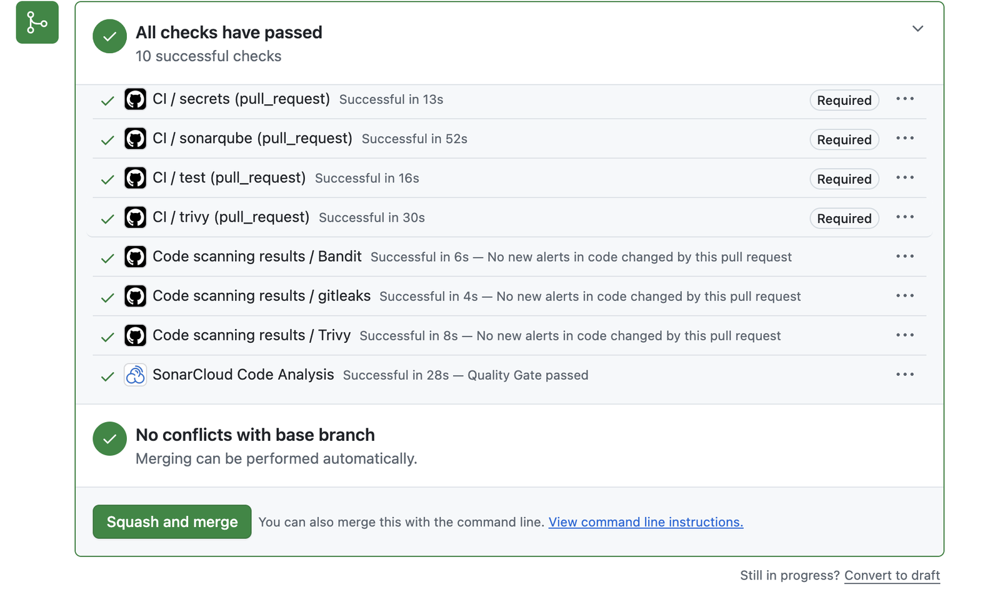
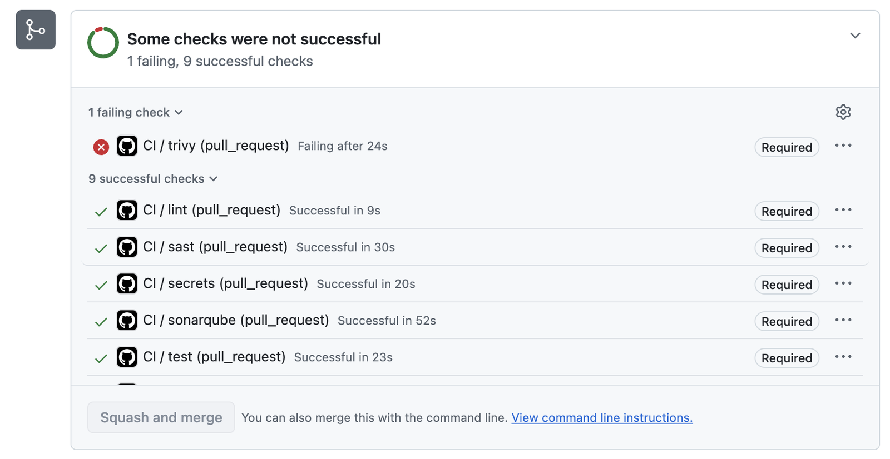
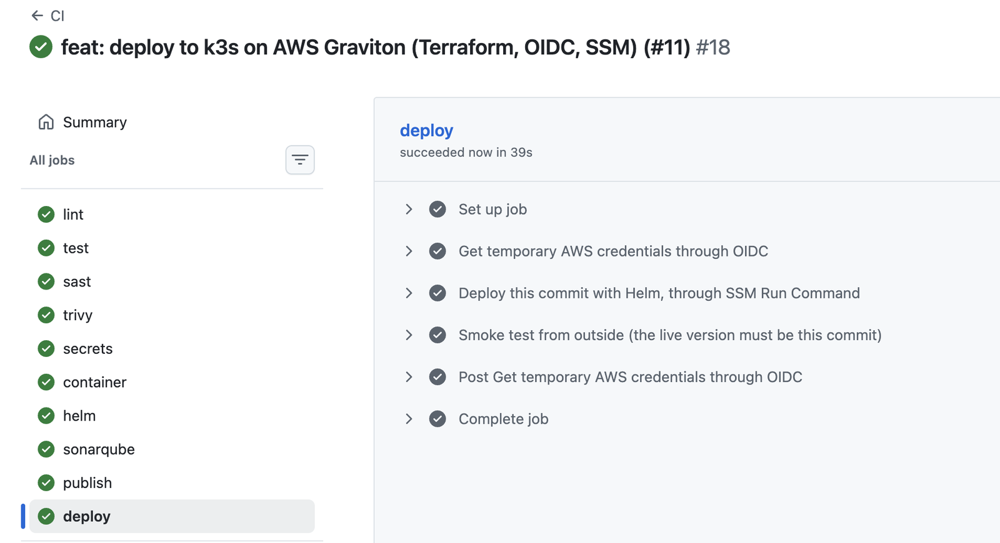
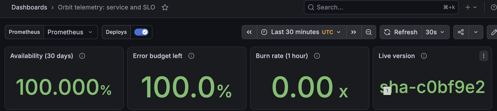
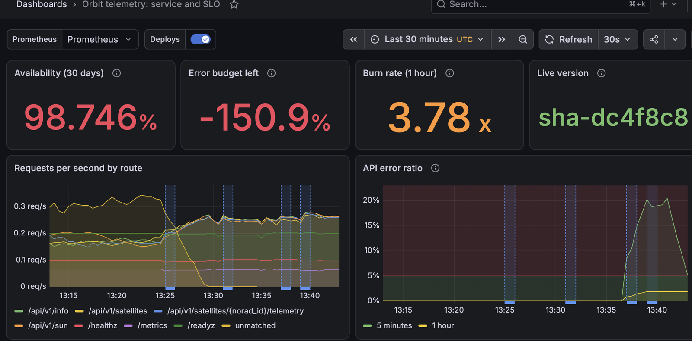
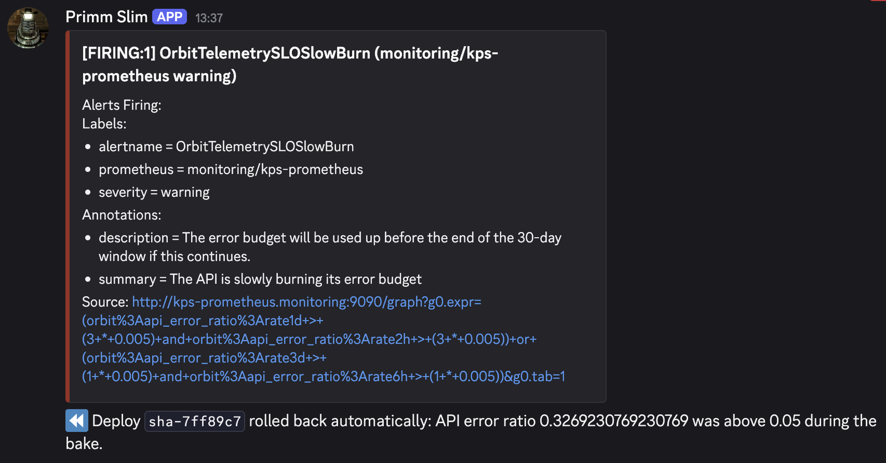
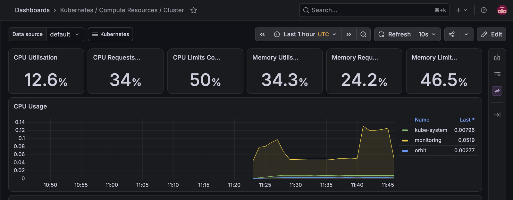

# Orbit Telemetry

[](https://github.com/ace-perez/orbit-telemetry/actions/workflows/ci.yml)
[](https://sonarcloud.io/summary/new_code?id=ace-perez_orbit-telemetry)
[](https://sonarcloud.io/summary/new_code?id=ace-perez_orbit-telemetry)
[](pyproject.toml)
[](LICENSE)

A live mission-control console that tracks five real satellites, and the CI/CD pipeline that builds, tests, secures, deploys and watches it.

Behind the console is a full delivery pipeline: every change is tested, scanned and deployed automatically, the system monitors its own health, and a bad release rolls itself back.

Built by Ace Perez for the DevOps Software Engineering module of the Postgraduate Diploma at Atlantic Technological University (ATU) Donegal, November 2026. For the story behind it, what broke, what the pipeline caught and what I learned, read the [build diary](docs/build-diary.md).



## What it does

- **Tracks real satellites.** The International Space Station, the Hubble Space Telescope, Sentinel-2A, NOAA 19 and Landsat 9. Their orbits come from [CelesTrak](https://celestrak.org) and are recalculated every second, so the position on the globe is where the satellite really is.
- **Shows a 3D globe.** Ground track for the next three orbits, the area each satellite can see, and which half of the Earth is in darkness right now.
- **Simulates the spacecraft.** Battery, solar panels and temperature respond to whether the satellite is in sunlight or in Earth's shadow. These values are simulated and labelled as such on the page; the orbits are real.
- **Offers an API** with interactive documentation at `/docs`.

**Live:** http://orbit.52.215.5.27.nip.io (running until the end of November 2026, then torn down to save cost; the screenshots below show it running).

## How a change reaches production

Every change goes through a pull request. Nothing can be pushed straight to `main`.



| Stage | What it checks | What happens if it fails |
|---|---|---|
| Lint and tests | Code style, 60+ unit tests (about 97% coverage) | Merge blocked |
| Security scans | Code (Bandit, SonarQube Cloud), dependencies and config (Trivy), leaked secrets (Gitleaks) | Merge blocked on high or critical findings |
| Container | Dockerfile rules (Hadolint), the finished image (Trivy) | Merge blocked |
| Kubernetes | The Helm chart is installed and tested in a throwaway cluster on every pull request | Merge blocked |
| Deploy | Live version and real error rate after release | Automatic rollback and an alert |

<table>
  <tr>
    <td width="50%"></td>
    <td width="50%"></td>
  </tr>
  <tr>
    <td><em>All checks green: ready to merge.</em></td>
    <td><em>A deliberately vulnerable dependency: one required check fails, so the merge is blocked.</em></td>
  </tr>
</table>



*Every merge to `main` runs the full pipeline and deploys itself, then checks the live site from outside.*

## Production-minded safeguards

- **No long-lived cloud keys.** GitHub proves its identity to AWS with short-lived tokens (OIDC) that only work for this repository's production environment.
- **No open SSH.** The server has no SSH port; administration and deploys go through AWS Systems Manager.
- **Pinned supply chain.** Every GitHub Action is pinned to an exact commit, and every downloaded tool is checked against a known checksum. This mattered: a popular scanner's own GitHub Action was hijacked in March 2026.
- **Secrets stay out of git.** Webhook and dashboard passwords live in AWS Parameter Store and are copied into the cluster at install time.
- **A strict web security policy.** The console loads nothing from other websites; its libraries and fonts are bundled and checksum-tested.
- **Private monitoring.** Grafana is never exposed to the internet; it is reached through an encrypted tunnel.

## Monitoring

Prometheus, Grafana and Loki run in the same cluster. The app is measured on rate, errors and duration, with a 99.5% availability target and alerts that fire when the error budget is being used up too fast. Alerts go to Discord. Dashboards are stored in the repository and deployed with the app.



*A normal day is where every single request was successfully serviced, the entire error budget remained unused and the currently running version in production.*

### The automatic rollback, proven

To prove the safety net works, I released a version that fails 30% of requests on purpose. The dashboard shows the error rate jumping past the 5% limit right after the deploy (blue markers) and falling back once the previous version was restored automatically. The red availability and negative error budget at the top are the cost of the demo itself, which is exactly what those numbers are for:



The same moment in Discord: the error-budget alert fired, and the deploy pipeline reported the automatic rollback:



## Problems caught and fixed

The pipeline and monitoring caught real problems during the build; each was fixed through a pull request:

- **The safety net had a hole.** A deliberately broken release (30% of requests failing) passed the post-deploy check, because failed requests were being labelled in a way the check could not see. Restored service first (#16), fixed the measurement and added a test for it (#17), then proved the rollback works (#18).
- **The rollback caught a second mistake on its own.** A revert pull request merged with no actual changes, which redeployed the broken setting. The post-deploy check rolled it back automatically, and the release history showed what had happened; fixed properly in #20.
- **Security scans found real vulnerabilities in the base image,** not the app's code. Fixed by upgrading the affected system libraries rather than hiding the findings (#8, #22).
- **AWS refused the first deploy** because GitHub had changed the format of its identity tokens for new repositories. Diagnosed and fixed in the trust policy (#12).

The whole process timeline is in the [build diary](docs/build-diary.md).

## Tech stack

| Area | Tools |
|---|---|
| App | Python 3.13, FastAPI, Skyfield (orbit calculations), D3 (globe) |
| Build and test | uv, pytest, Ruff, Docker (multi-stage, non-root) |
| Security | Bandit, SonarQube Cloud, Trivy, Gitleaks, Hadolint |
| CI/CD | GitHub Actions, GitHub Container Registry |
| Infrastructure | Terraform, AWS (EC2 Graviton, IAM, Systems Manager, Budgets), k3s, Helm |
| Monitoring | Prometheus, Alertmanager, Grafana, Loki, Alloy, Discord |

## Design choices and trade-offs

Every choice here was made for a one-week project on a student budget. Each one has a cost, and the table says what it is.

| Choice | Why | Trade-off |
|---|---|---|
| **k3s on one EC2 server** instead of Amazon EKS | Real Kubernetes, with the same Helm chart and the same tools, for the price of a single server. EKS charges about $0.10 an hour for its control plane alone, before any server runs the app. | One server is a single point of failure: if it goes down, the app and its monitoring go down together. A real production service would run several nodes, or a managed cluster. |
| **AWS Graviton (ARM)** instead of Intel | Cheaper for the same memory, which matters on a paid account with no credits. | The image must be built for ARM, so the image jobs in CI moved to ARM runners. That turned out well: the image tested in CI is the exact one that runs. |
| **Deploy through AWS Systems Manager, logged in with GitHub OIDC** | No SSH port open, and no AWS keys stored in GitHub that could leak. | The pipeline pushes each release to the server. A GitOps tool (Flux or Argo CD) would let the cluster pull its own state from git, which is more robust, but it is one more system to run. |
| **GitHub Container Registry** instead of Amazon ECR | Free, sits next to the code, and needs no extra AWS permissions. | The images live outside AWS, and they are public. |
| **Several security scanners** (Bandit, SonarQube Cloud, Trivy, Gitleaks, Hadolint) | Each catches something the others miss: code flaws, vulnerable packages, leaked secrets, Dockerfile mistakes. One of them caught a real mistake the others passed. | A slower pipeline, and more findings to triage. Every finding gets a decision and a written reason. |
| **Self-hosted Prometheus, Grafana and Loki** instead of CloudWatch or a paid tool | Free, industry-standard, and the dashboards and alerts are code in the repository. | They use resources on the same server as the app, and they would go down with it. An external uptime check would cover that gap. |
| **Post-deploy check with automatic rollback** instead of a canary release | Simple, works with a single copy of the app, and it caught two real bad releases. | Every user sees a bad release for the 2.5 minutes the check takes. A canary would expose only a small share of traffic first. |
| **Real orbits, simulated spacecraft data** | Real positions from CelesTrak make the demo checkable against other trackers. No public source offers live battery data for these satellites. | Power and thermal values are made up, and the page labels them as simulated. |
| **Web libraries bundled into the image** instead of loaded from a CDN | The page can use a strict security policy and makes no requests to other sites. | Updates are manual: Dependabot cannot see bundled files, so a checksum test makes every change deliberate. |
| **HTTP only, for now** | HTTPS was planned, built and tested, and will be implemented later on. | Traffic to the live site is not encrypted. Nothing sensitive is served, and Grafana is never public. |

## Run it locally

You need Docker. This starts the app with test satellite data (no internet needed for the orbits), plus Prometheus:

```bash
docker compose up --build --wait
```

Then open http://localhost:8000 for the console and http://localhost:8000/docs for the API. Stop it with `docker compose down`.

## Repository layout

| Path | Contents |
|---|---|
| `src/orbit_telemetry/` | The app: API, orbit calculations, simulated subsystems, the console page |
| `tests/` | Unit tests (offline, fixed clock) and integration tests against a running stack |
| `charts/orbit-telemetry/` | Helm chart: deployment, health checks, alerts, dashboards |
| `infra/terraform/` | AWS infrastructure as code |
| `deploy/` | Production values, release script with the post-deploy check, monitoring install |
| `.github/workflows/ci.yml` | The whole pipeline |

## Cost

A single Graviton server (t4g.large, about $0.07 an hour) runs only for the assessment week, with a $20 budget alarm. `terraform destroy` removes everything.

The whole cluster, monitoring stack included, uses about an eighth of the server's CPU and a third of its memory:



## What I would do next

- HTTPS with an automatically renewed certificate (planned and tested, not yet released)
- Satellite pass predictions for Dublin and live space weather from NOAA (built, not yet released)
- Canary releases instead of all-at-once deploys, and a monitoring check that runs outside the server
- A smaller base image to remove most of the remaining operating-system packages

## License

MIT